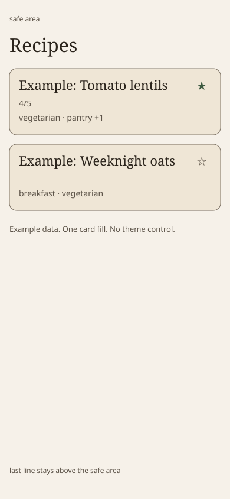
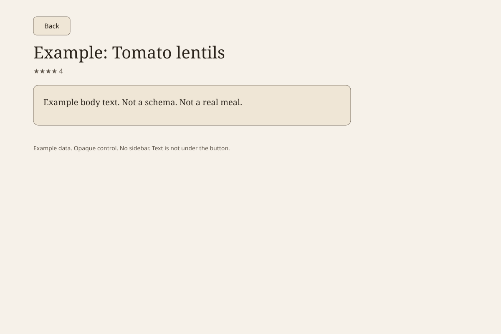
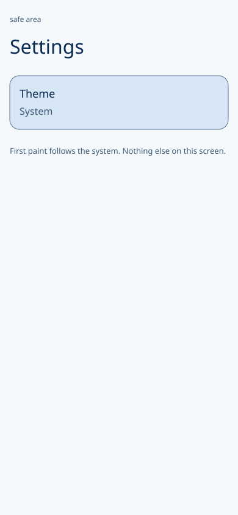

# Information architecture

Screens for [0016](../decisions/0016-kitchen-ui.md) and [0020](../decisions/0020-kitchen-design-system.md). The list and recipe screens are in the tree. Settings is not.

Three screens: a list of recipes, one recipe opened to read and cook, and settings. Chrome is [chrome](chrome.md).

Wireframes use invented example recipes. They are not household data. They do not yet show the two-column recipe or the list filters.

## Routes

| Route | What it is |
| --- | --- |
| `/` | The list. A card opens the recipe. |
| `/recipes/:id` | One recipe. `:id` is explicit in the example data. |
| `/settings` | Theme only. |

`/guide` is the review route from [demo](demo.md). It is not part of this information architecture.

## Screens

### List

The title "Recipes" is the first line of the content. A favorites toggle narrows the list to favorites. Tag filter chips narrow it to recipes that have the chosen tags. Both can be on at once. No chip chosen means every tag. Free-text search is not offered.

Cards are a single column on the phone and a grid from the wide breakpoint up. Empty library: "No recipes yet." No rows after a filter: "No recipes match." Failure, after the page has loaded: "Could not load recipes." and a way to try again. The last line stays clear of the safe area. There is no theme control on this screen.

### Cards

The whole card is one link to the recipe. The title is sans, at most two lines, then an ellipsis. Under the title, four equal facts slots show primary protein, total time, effort, and meal types. Missing slots keep a dash. Slot explanations on the card are hover copy plus the link name; they are not nested buttons. The same four-slot component is on the recipe screen, where explanations are also keyboard-focusable.

Every card has a favorite star toggle, top-right, with a 44px hit area. It is a sibling button, not nested inside the link. Accessible name `Favorite` plus the title. `aria-pressed` reflects the state. It updates optimistically, with rollback and a worded error, per [buttons](buttons.md).

The rating is read-only on the list: compact stars plus a number, only when the recipe is rated. No empty stars. The accessible name is the score, for example `4/5`. The rating is set on the recipe screen.

The meta line shows up to two tags as plain text joined by ` · `, then `+N` for the rest. Tags on cards are not tappable. Filtering is the chips above the list.

Cards do not show nutrition, author, ingredients, dates, or photos.

Reserve the meta line even when there are no tags, so heights stay stable. Skeleton cards match that size.

### Recipe

Reading and cooking help. One `h1`, the example title. Ingredients and steps sit side by side from the wide breakpoint up, and stack on the phone. Each ingredient is one written line. Steps stay in saved order. A cooking session shows the snapshot from when it started. The displayed step and completed steps are separate controls. That session is shared. A device-local check-off, when no session is active, stays on this browser and is not written through the API.

While this screen is open, the app asks the OS to keep the display awake. If the browser cannot, the recipe still shows.

Favorite and rating are the phone writes. They are offered on this screen. Back returns to the list. It uses an opaque fill and does not cover the title, the ingredient lines, or the steps. The last line stays clear of Back and of the safe area.

Nutrition, when present, is shown. This screen shows the title, facts, ingredient lines, steps, nutrition when present, favorite, and rating. The rating is set here, not on the list. **Edit recipe facts** is a small form on this screen only.

### Settings

Title: Settings. The only choice is Theme. The default is the system setting. Placement of that control is pending.

## Example cards

Titles start with `Example:`. Ids are explicit. The same data can show the list, one recipe, an empty list, a filtered-empty list, and a failed load. That failed load is after the page has loaded. A document that never arrives is the browser error page ([0016](../decisions/0016-kitchen-ui.md)).

| Id | Title | Tags | Rating | Favorite |
| --- | --- | --- | --- | --- |
| `example-tomato-lentils` | Example: Tomato lentils | vegetarian, pantry, weeknight | 4/5 | on |
| `example-weeknight-oats` | Example: Weeknight oats | breakfast, vegetarian | | off |
| `example-citrus-chicken` | Example: Citrus chicken | dinner | 5/5 | off |

## Tags

The data model treats tags as one list ([0019](../decisions/0019-v1-recipe-data-model.md)). The documented API list item is id, title, and facts. The read field list has no tags. Tag chips need tags on the list payload. That is an API gap, not a screen invention.
