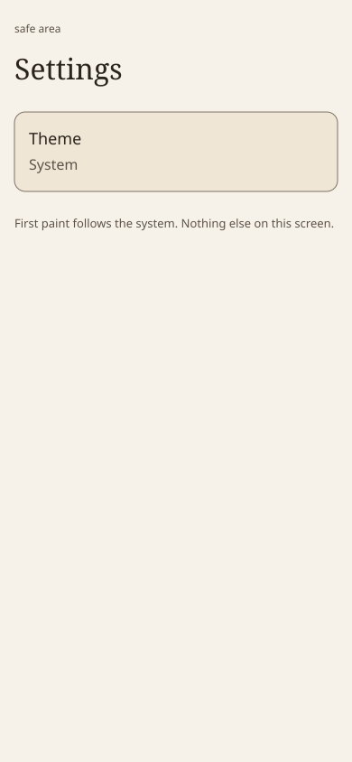

# Information architecture

Screens for [0016](../decisions/0016-kitchen-ui.md). Not in the tree.

v1 is three screens: a list of recipes, one recipe opened to read, and settings. Search, weekly planning, fullscreen, live updates, and a Chef panel are later. Chrome is [chrome](chrome.md).

Wireframes use invented example recipes. They are not household data.

## Routes

| Route | v1 | What it is |
| --- | --- | --- |
| `/` | yes | The list. A card opens the recipe. |
| `/recipes/:id` | yes | One recipe. `:id` is explicit in the example data. |
| `/settings` | yes | Theme only, for now. |

`/guide` is the review route from [0018](../decisions/0018-ui-demos.md). It is not part of this information architecture.

## Screens

### List

The title "Recipes" is the first line of the content. Cards show the example title and one muted line: `Placeholder meta · fields undecided`. The whole card is the link. Each card is one fill. Empty: "No recipes yet." Failure, after the page has loaded: "Could not load recipes." and a way to try again. The last line stays clear of the safe area. There is no theme control on this screen.

### Recipe

One `h1`, the example title. Then `Placeholder meta · fields undecided`. Then placeholder body text. Those lines are not a schema. Back returns to the list. It uses an opaque fill and does not cover the title or the body. The last line stays clear of Back and of the safe area.

### Settings

Title: Settings. The only choice, for now, is Theme. The default is the system setting. This screen does not decide whether the control is a menu button or a control at the top of the screen.

## Example cards

Titles start with `Example:`. Ids are explicit. The body is placeholder text and does not name schema fields. The same data can show the list, one recipe, an empty list, and a failed load. That failed load is after the page has loaded. A document that never arrives is the browser error page ([0016](../decisions/0016-kitchen-ui.md)).

| Id | Title | Placeholder meta |
| --- | --- | --- |
| `example-tomato-lentils` | Example: Tomato lentils | Placeholder meta · fields undecided |
| `example-weeknight-oats` | Example: Weeknight oats | Placeholder meta · fields undecided |
| `example-citrus-chicken` | Example: Citrus chicken | Placeholder meta · fields undecided |
